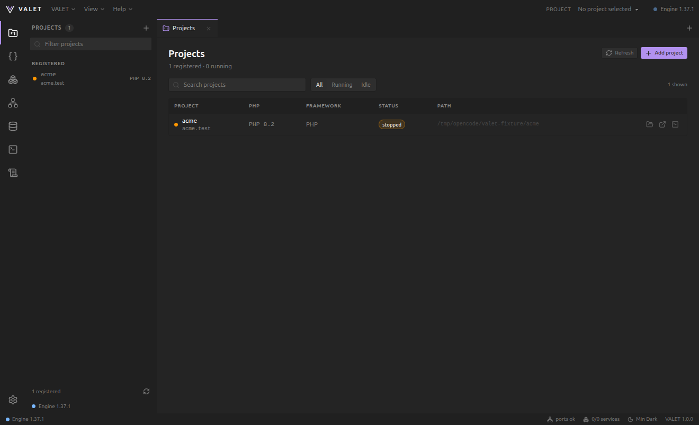
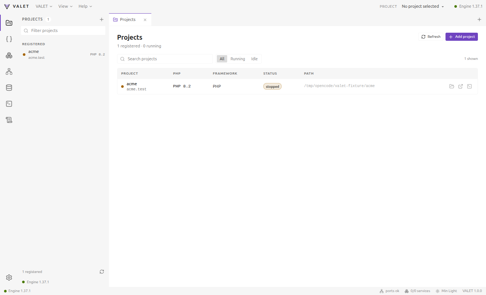
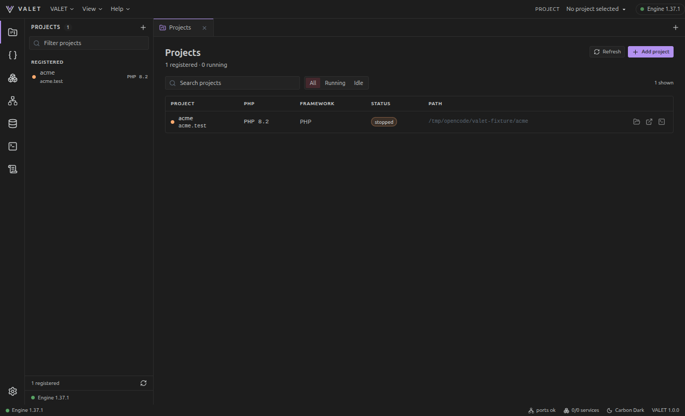
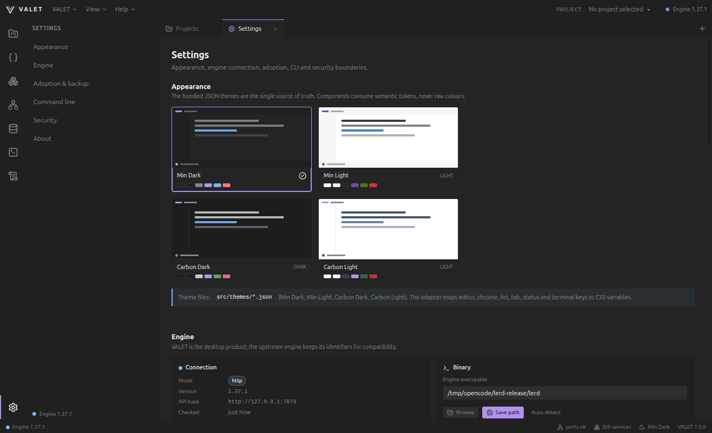
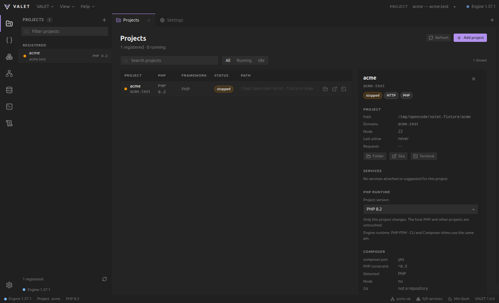
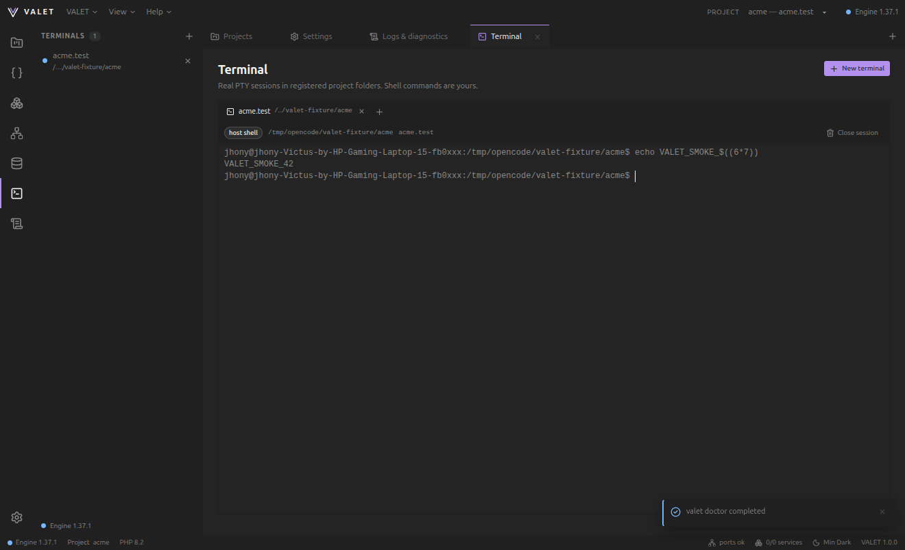
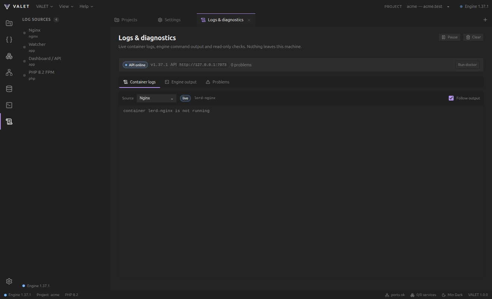
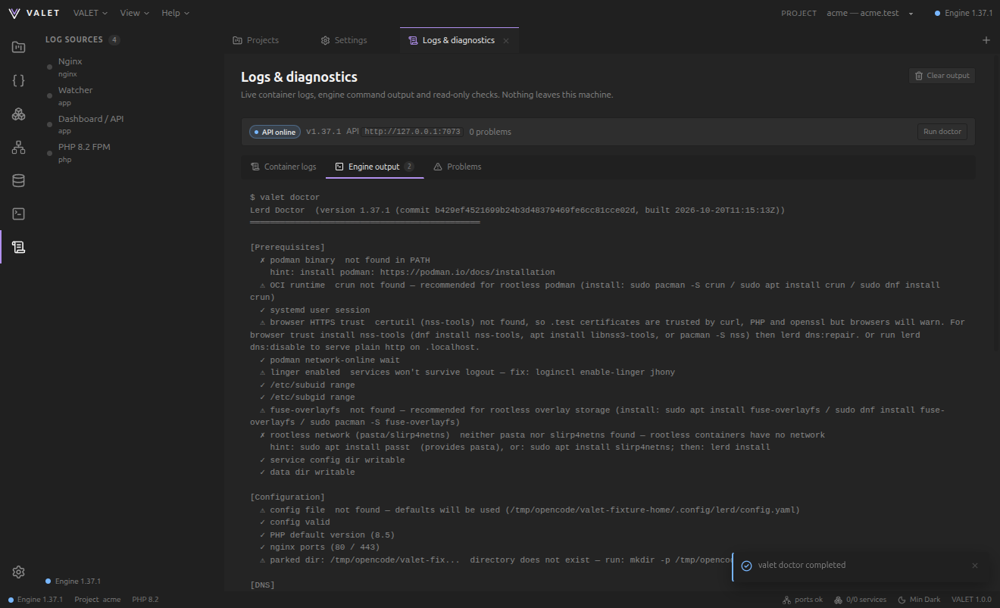

# VALET

VALET is a minimalist desktop control plane for local PHP development. It is a
VS Code–inspired workbench over the existing **Lerd** engine: projects, PHP
runtimes, services, ports, terminals, logs and diagnostics live in one window,
while the engine keeps its own containers, volumes, configuration and data.

The interface is intentionally small, keyboard-friendly and ships with four
theme documents: **Min Dark**, **Min Light**, **Carbon Dark** and **Carbon
Light**.





Screenshots capture the app's web contents only. The operating system's title
bar and native window buttons are not part of the page, so they do not appear.

The Appearance settings list every bundled theme, including the two Carbon
documents:



Project detail with a framework-suggested service and the isolated PHP runtime
selector:



Terminals now live only in their own activity-bar view:



Logs & diagnostics keeps live container logs, engine command output and the
problem list in one place — there is no bottom panel:



The same view shows real `valet doctor` output under **Engine output**:



## Status

This repository contains a complete, buildable first release:

- Electron shell with a typed, validated preload bridge and the operating
  system's native window frame and minimise/maximise/close controls on Windows
  and Linux; macOS keeps its native inset traffic lights.
- React + Vite workbench: app toolbar, activity bar, sidebar, tabbed views,
  status bar and command palette.
- Real engine integration through the Lerd loopback HTTP API and a narrow CLI
  allow-list. The renderer never receives `child_process`, `fs` or arbitrary
  IPC.
- Per-project PHP pinning without touching host PHP, with automatic restoration
  of the previous pin when the engine reports a failed switch. The PHP view
  reports the engine default, FPM running/stopped state, patch build and xdebug
  mode from `/api/status`.
- Port inventory for host and container ports, including secondary mappings,
  conflict detection, validation and `127.0.0.1` defaults. Start is blocked
  when the engine reports any required port busy.
- Project service management: attached and env-detected services, framework
  suggestions, and confirmed add, detach, declare or dismiss actions.
- Real PTY-backed terminals via `script(1)` in a dedicated activity-bar view,
  multiple sessions, scrollback replay and engine `php`/`composer` shims first on
  `PATH` when they are installed.
- Live service and PHP logs through the engine's SSE endpoints, plus engine
  command output and problems inside Logs & diagnostics.
- In-place migration with a checksum-verified backup; no containers, volumes
  or project files are copied or moved.
- `valet` CLI with the same engine adapter, validation and exit codes.
- phpMyAdmin retired from active UI/CLI features. Existing data is untouched;
  only the legacy container can be removed explicitly.

The engine API was exercised against a live Lerd v1.37.1 `serve-ui` process
during verification. See [docs/TESTING.md](docs/TESTING.md) for exactly what was
and was not exercised.

## Requirements

- Linux or macOS (the upstream engine targets these platforms).
- Node.js 20+ and npm for building from source.
- A Lerd engine binary for management actions. The engine API may already be
  running independently; VALET detects both modes.
- Podman and the engine's normal runtime dependencies only if you use the
  engine's containers. VALET never installs Podman or changes host PHP.

The app can start with the engine offline and shows an offline banner instead of
failing. Management actions become available when the engine is reachable.

## Development

```bash
npm install
npm run dev          # Vite + Electron with the development server
npm test             # Vitest unit/integration tests
npm run typecheck
npm run build        # renderer + Electron main + CLI
npm run smoke        # themes, project, logs, output and terminal screenshots
```

`npm run package` creates an unpacked application in `release/linux-unpacked`
on Linux. `npm run dist` creates the configured AppImage/deb artifacts.

The engine is detected automatically on `PATH`, through `VALET_ENGINE_BIN`, or
from `enginePath` in `~/.config/valet/desktop.json`. For an already running API,
set `VALET_ENGINE_URL` (loopback URL recommended). The default is
`http://127.0.0.1:7073`.

## CLI

The CLI is built to `dist/cli/valet.js` and wrapped by `bin/valet`:

```bash
npm run build:cli
./bin/valet doctor
./bin/valet status
./bin/valet projects
./bin/valet services
./bin/valet ports
./bin/valet databases
./bin/valet php
```

See [docs/CLI.md](docs/CLI.md) for every command, JSON output and safety
behaviour. `scripts/install-cli.sh` refuses to overwrite an existing `valet`
that is not this repository's wrapper, because Laravel Valet uses the same
command name.

## Architecture at a glance

```text
┌───────────────────────────── Electron window ─────────────────────────────┐
│ React renderer (sandboxed, no Node)                                      │
│   workbench views ── typed window.valet API ── contextBridge             │
└───────────────────────────────┬───────────────────────────────────────────┘
                                │ validated IPC (main process only)
┌───────────────────────────────▼───────────────────────────────────────────┐
│ Electron main                                                             │
│  IPC validation · ports/host scan · PTY manager · SSE log streamer       │
│  shared engine adapter (HTTP client + CLI allow-list)                     │
└───────────────────────────────┬───────────────────────────────────────────┘
                                │ loopback HTTP / execFile
┌───────────────────────────────▼───────────────────────────────────────────┐
│ Existing Lerd engine (unchanged)                                          │
│  containers · volumes · sites.yaml · certificates · PHP images            │
└───────────────────────────────────────────────────────────────────────────┘
```

The full design, technology decision and module map are in
[docs/ARCHITECTURE.md](docs/ARCHITECTURE.md).

## Documentation

- [Architecture and technology decision](docs/ARCHITECTURE.md)
- [Migration and recovery](docs/MIGRATION.md)
- [Themes and accessibility](docs/THEMES.md)
- [CLI reference](docs/CLI.md)
- [Compatibility and preserved identifiers](docs/COMPATIBILITY.md)
- [Renaming table](docs/RENAMING.md)
- [Security model](docs/SECURITY.md)
- [Diagnostics](docs/DIAGNOSTICS.md)
- [Testing evidence](docs/TESTING.md)

## Compatibility promise

VALET is an interface layer, not a replacement engine. It preserves:

- the `lerd` binary, API and command names;
- `.lerd.yaml`, `sites.yaml`, `config.yaml` and persisted engine keys;
- Podman containers, volumes, images, networks and certificates;
- project directories and database contents;
- upstream copyright and MIT license notices.

No automatic migration moves or duplicates data. `valet migrate apply` only
writes a verified copy of engine configuration under VALET's config directory
and records an adoption manifest. See [docs/MIGRATION.md](docs/MIGRATION.md)
and [docs/COMPATIBILITY.md](docs/COMPATIBILITY.md).

## Licensing

VALET Desktop is MIT-licensed. The Lerd engine is a separate MIT-licensed
project by George Dumitrescu; its binary is not bundled here. The Min themes are
by Miguel Solorio and are also MIT-licensed. Carbon Dark and Carbon Light are
bundled from the repository's existing theme assets. See [LICENSE](LICENSE) and
[NOTICE](NOTICE).
